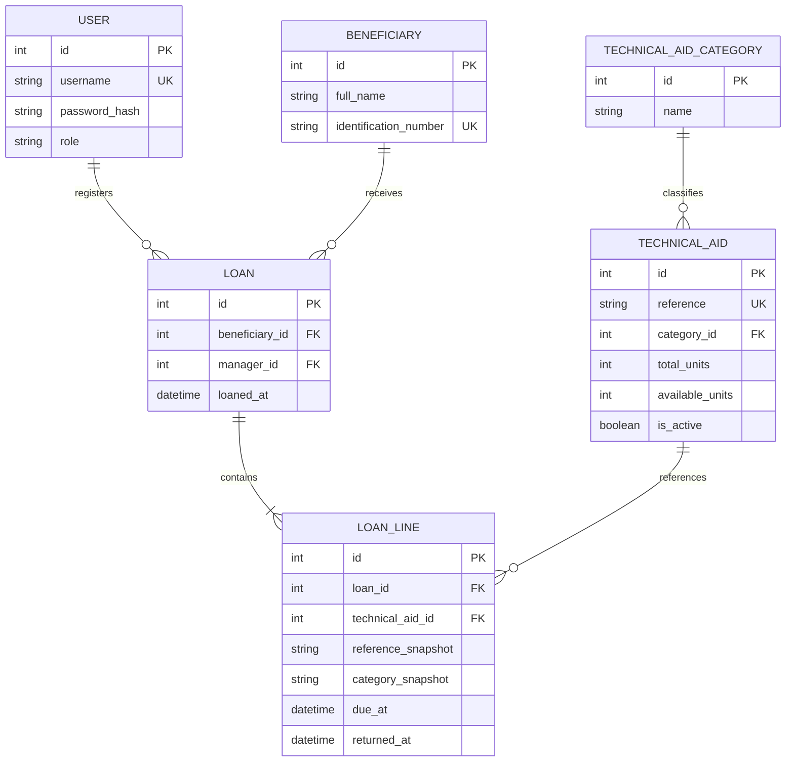

# Data Model — Mobility Aids

**Project:** Mobility Aids  
**Identifier:** `mobility-aids`  
**Document type:** Logical Data Model  
**Status:** Draft for review
--------------------------------------------------------------------------------
## 1. Purpose

This document defines the logical data model for the Mobility Aids system.

The model represents the technical aids catalog, beneficiaries, system users, loans, and loan history.

It is based on the requirements established in `spec.md` and the assigned domain described in Acta 18-2026.

This document describes logical entities and relationships. It does not define physical database types or implementation-specific SQL.
--------------------------------------------------------------------------------
## 2. Main Entities

The system contains the following logical entities:

1. User
2. Beneficiary
3. TechnicalAidCategory
4. TechnicalAid
5. Loan
6. LoanLine
--------------------------------------------------------------------------------
## 3. Entity Definitions

### 3.1 User

Represents an authenticated system user.

| Attribute | Description |
|---|---|
| id | Unique user identifier. |
| username | Unique username. |
| password_hash | Securely stored password hash. |
| role | User authorization role: `admin` or `manager`. |

**Responsibilities:**
- Authenticate system users.
- Identify the manager responsible for a loan.
- Enforce role-based access.

### 3.2 Beneficiary

Represents a person who receives technical aids through the lending process.

| Attribute | Description |
|---|---|
| id | Unique beneficiary identifier. |
| full_name | Beneficiary's full name. |
| identification_number | Unique identification document number. |

**Responsibilities:**
- Identify the recipient of technical aids.
- Maintain beneficiary information.
- Associate beneficiaries with their loan history.

### 3.3 TechnicalAidCategory

Represents the predefined categories of technical aids.

| Attribute | Description |
|---|---|
| id | Unique category identifier. |
| name | Category name. |

**Seeded categories:**

1. Wheelchairs
2. Crutches
3. Walkers
4. Canes
5. Cushions

### 3.4 TechnicalAid

Represents a technical aid registered in the catalog.

| Attribute | Description |
|---|---|
| id | Unique technical aid identifier. |
| reference | Unique technical aid reference. |
| category_id | Associated category identifier. |
| total_units | Total registered units. |
| available_units | Units currently available. |
| is_active | Indicates whether the catalog record is active. |

**Responsibilities:**
- Identify technical aids through their references.
- Maintain total and available inventory.
- Prevent negative inventory.
- Support logical deletion without destroying historical records.

**Inventory invariant:**

`0 <= available_units <= total_units`

### 3.5 Loan

Represents a lending operation associated with one beneficiary and one responsible manager.

| Attribute | Description |
|---|---|
| id | Unique loan identifier. |
| beneficiary_id | Beneficiary receiving the technical aids. |
| manager_id | User responsible for registering the loan. |
| loaned_at | Date and time when the loan was registered. |

**Responsibilities:**
- Associate a beneficiary with a lending operation.
- Identify the responsible manager.
- Maintain the historical lending record.
- Group the technical aids included in the operation.

### 3.6 LoanLine

Represents an individual technical aid included in a loan.

| Attribute | Description |
|---|---|
| id | Unique loan line identifier. |
| loan_id | Associated loan identifier. |
| technical_aid_id | Original technical aid identifier. |
| reference_snapshot | Technical aid reference at the time of lending. |
| category_snapshot | Category at the time of lending. |
| due_at | Expected return date. |
| returned_at | Actual return date; null when not returned. |

**Responsibilities:**
- Record each technical aid delivered.
- Preserve historical information independently of future catalog changes.
- Track the expected and actual return dates.
- Prevent duplicate returns.

The due date is calculated using the 30-day lending period established in the project rules.
--------------------------------------------------------------------------------
## 4. Entity Relationships

| Relationship | Cardinality | Description |
|---|---|---|
| TechnicalAidCategory → TechnicalAid | 1:N | One category can contain multiple technical aids. |
| Beneficiary → Loan | 1:N | One beneficiary can have multiple historical loans. |
| User → Loan | 1:N | One manager can register multiple loans. |
| Loan → LoanLine | 1:N | One loan contains one or more technical aid lines. |
| TechnicalAid → LoanLine | 1:N | One technical aid can appear in multiple historical loan lines. |
--------------------------------------------------------------------------------
## 5. Relationship Diagram

--------------------------------------------------------------------------------
## 6. Business Constraints

The logical model must preserve the following constraints:

### 6.1 Inventory Integrity

- Available units cannot be negative.
- Available units cannot exceed total units.
- Loan registration decreases available inventory.
- Return registration increases available inventory.
- Inventory modifications must be atomic.

### 6.2 Beneficiary Loan Limits

- A beneficiary cannot have more than two outstanding technical aids.
- A beneficiary with overdue technical aids cannot receive additional aids until the overdue items are returned.

### 6.3 Loan History

- Loan records cannot be deleted.
- Return records cannot be deleted.
- Catalog deactivation must preserve historical loan information.
- Snapshot information must remain unchanged when catalog records are updated.

### 6.4 Date Management

- Dates and timestamps are stored and processed in UTC.
- The expected return date follows the 30-day lending period.
- An unreturned loan line becomes overdue when its due date has passed.
--------------------------------------------------------------------------------
## 7. Data Integrity and Concurrency

Inventory operations must preserve consistency when multiple managers attempt to register loans simultaneously.

When only one unit is available and two managers attempt to deliver it:

- Only one operation can succeed.
- The other operation must receive HTTP 409.
- Inventory must never become negative.
- No incomplete loan must remain registered.

Returns must also prevent duplicate inventory increases.
--------------------------------------------------------------------------------
## 8. Historical Data Preservation

The system must preserve the information associated with completed and pending lending operations.

Catalog changes must not modify historical snapshot information.

Loan and return history must remain available for consultation and reporting.
--------------------------------------------------------------------------------
## 9. Source of Truth

The official project requirements are established in Acta 18-2026 and the approved project specification in `spec.md`.

The logical model must remain consistent with those documents.

Physical database types, migrations, indexes, and implementation details will be defined during the architecture and implementation stages.
--------------------------------------------------------------------------------
**End of Data Model — Mobility Aids**