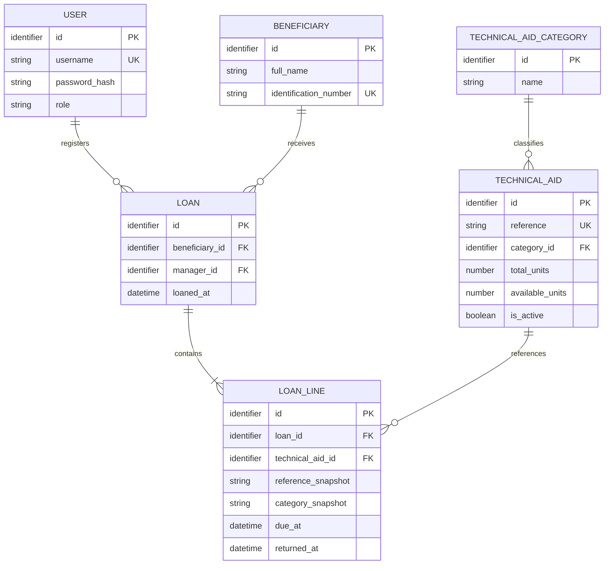

# Data Model — Mobility Aids

**Project:** Mobility Aids | **Identifier:** `mobility-aids` | **Document type:** Logical Data Model
**Version:** 1.2 | **Reviewed:** 2026-11-26
**Status:** Logical target model; implementation verification remains in progress.

------------------------------------------------------------------------------------------------------------------------

## 1. Purpose

This document defines the logical data model for the Mobility Aids system.

The model represents the technical aids catalog, beneficiaries, authenticated system users, loans, and loan history.

It is based on the requirements established in `spec.md` and the assigned domain described in Acta 18-2026.

This document describes logical entities, attributes, relationships, and business constraints. It does not define physical database types, SQL implementation details, or database-specific configurations.

The logical entity `LoanLine` corresponds to the Laravel model of the same name in the current source tree. This naming correspondence does not establish that every logical constraint has been verified against a running database.

## 2. Main Entities

The system contains the following logical entities:

1. User
2. Beneficiary
3. TechnicalAidCategory
4. TechnicalAid
5. Loan
6. LoanLine

These entities represent the main information required to manage the technical aids catalog and the lending and return processes.

## 3. Entity Definitions

### 3.1 User

Represents an authenticated system user.

| Attribute | Description |
|---|---|
| id | Unique user identifier. |
| username | Unique username. |
| password_hash | Securely stored password hash. |
| role | User authorization role: `admin` or `manager`. |

**Responsibilities:**

- Authenticate system users.
- Identify the manager responsible for registering a loan.
- Enforce role-based access control.
- Associate loan operations with the responsible manager.

**Constraints:**

- Usernames must be unique.
- Passwords must be stored securely as hashes.
- The system supports the `admin` and `manager` roles.
- The admin role is provisioned during deployment and cannot be assigned through the API.

### 3.2 Beneficiary

Represents a person who receives technical aids through the lending process.

| Attribute | Description |
|---|---|
| id | Unique beneficiary identifier. |
| full_name | Beneficiary's full name. |
| identification_number | Unique identification document number. |

**Responsibilities:**

- Identify the recipient of technical aids.
- Maintain beneficiary information.
- Associate beneficiaries with their loan history.
- Support the validation of beneficiary lending restrictions.

**Constraints:**

- The identification document number must be unique.
- A beneficiary does not require a system account to receive technical aids.

### 3.3 TechnicalAidCategory

Represents the predefined categories of technical aids.

| Attribute | Description |
|---|---|
| id | Unique category identifier. |
| name | Category name. |

**Seeded categories:**

1. Wheelchairs
2. Crutches
3. Walkers
4. Canes
5. Cushions

**Responsibilities:**

- Classify technical aids.
- Maintain the predefined catalog categories.
- Support technical aid filtering and consultation.

### 3.4 TechnicalAid

Represents a technical aid registered in the catalog.

| Attribute | Description |
|---|---|
| id | Unique technical aid identifier. |
| reference | Unique technical aid reference. |
| category_id | Associated category identifier. |
| total_units | Total registered units. |
| available_units | Units currently available. |
| is_active | Indicates whether the catalog record is active. |

**Responsibilities:**

- Identify technical aids through their references.
- Maintain total and available inventory.
- Support inventory availability checks.
- Prevent negative inventory.
- Support logical deactivation without destroying historical records.

**Constraints:**

- The technical aid reference must be unique.
- Available units cannot exceed total units.
- Inactive catalog records must preserve their historical associations.

**Inventory invariant:**

`0 <= available_units <= total_units`

### 3.5 Loan

Represents a lending operation associated with one beneficiary and one responsible manager.

| Attribute | Description |
|---|---|
| id | Unique loan identifier. |
| beneficiary_id | Beneficiary receiving the technical aids. |
| manager_id | User responsible for registering the loan. |
| loaned_at | Date and time when the loan was registered. |

**Responsibilities:**

- Associate a beneficiary with a lending operation.
- Identify the responsible manager.
- Maintain the historical lending record.
- Group the technical aids included in the operation.

**Constraints:**

- Each loan belongs to one beneficiary.
- Each loan identifies one responsible manager.
- A loan contains one or more loan lines.
- Loan records cannot be deleted.

### 3.6 LoanLine

Represents an individual technical aid included in a loan.

| Attribute | Description |
|---|---|
| id | Unique loan line identifier. |
| loan_id | Associated loan identifier. |
| technical_aid_id | Original technical aid identifier. |
| reference_snapshot | Technical aid reference at the time of lending. |
| category_snapshot | Category at the time of lending. |
| due_at | Expected return date. |
| returned_at | Actual return date; null when not returned. |

**Responsibilities:**

- Record each technical aid delivered.
- Preserve historical information independently of future catalog changes.
- Track the expected and actual return dates.
- Identify outstanding and overdue technical aids.
- Prevent duplicate returns.

**Constraints:**

- Each loan line belongs to one loan.
- Each loan line references one technical aid.
- Snapshot information must remain unchanged when catalog records are updated.
- A loan line can only be returned once.
- The return operation is recorded through `returned_at`.

The due date is calculated using the 30-day lending period established in the project rules.

## 4. Entity Relationships

| Relationship | Cardinality | Description |
|---|---|---|
| TechnicalAidCategory → TechnicalAid | 1:N | One category can contain multiple technical aids. |
| Beneficiary → Loan | 1:N | One beneficiary can have multiple historical loans. |
| User → Loan | 1:N | One manager can register multiple loans. |
| Loan → LoanLine | 1:N | One loan contains one or more technical aid lines. |
| TechnicalAid → LoanLine | 1:N | One technical aid can appear in multiple historical loan lines. |

These relationships preserve the association between beneficiaries, responsible managers, technical aids, and lending history.

## 5. Relationship Diagram

The following diagram represents the logical relationships between the main entities.

**Diagram note:** The attribute labels represent logical concepts. They do not establish physical database column types or a specific database engine.

## 6. Business Constraints

The logical model must preserve the following business constraints.

### 6.1 Inventory Integrity

- Available units cannot be negative.
- Available units cannot exceed total units.
- Loan registration decreases available inventory.
- Return registration increases available inventory.
- Inventory modifications must be atomic.
- Inventory availability must remain consistent when simultaneous loan operations occur.

### 6.2 Beneficiary Loan Limits

- A beneficiary cannot have more than two outstanding technical aids.
- A beneficiary with overdue technical aids cannot receive additional aids until the overdue items are returned.
- Loan registration must validate these restrictions before confirming the operation.

### 6.3 Loan History

- Loan records cannot be deleted.
- Return history cannot be deleted.
- Catalog deactivation must preserve historical loan information.
- Snapshot information must remain unchanged when catalog records are updated.
- Historical lending operations must remain available for consultation.

### 6.4 Date Management

- Dates and timestamps are stored and processed in UTC.
- The expected return date follows the 30-day lending period.
- An unreturned loan line becomes overdue when its due date has passed.
- A returned loan line is identified by its `returned_at` value.

## 7. Data Integrity and Concurrency

Inventory operations must preserve consistency when multiple managers attempt to register loans simultaneously.

When only one unit is available and two managers attempt to deliver it:

- Only one operation can succeed.
- The other operation must receive HTTP `409 Conflict`.
- Inventory must never become negative.
- No incomplete loan must remain registered.
- Inventory updates and loan registration must be handled atomically.

Returns must also prevent duplicate inventory increases.

A loan line that has already been returned cannot be returned again. The return operation must validate its current state before updating inventory.

## 8. Historical Data Preservation

The system must preserve the information associated with completed and pending lending operations.

The following rules apply:

- Catalog changes must not modify historical snapshot information.
- Loan and return history must remain available for consultation and reporting.
- Technical aids must be logically deactivated instead of physically deleting records associated with historical operations.
- Each loan line must preserve the technical aid reference and category that existed when the loan was registered.
- Return information must remain associated with its original loan line.

This approach ensures that historical records remain consistent even when catalog information changes.

## 9. Data Integrity and Validation Summary

The logical model must support the following validations:

| Validation | Expected behavior |
|---|---|
| Unique username | Prevent duplicate system usernames. |
| Unique beneficiary identification | Prevent duplicate beneficiary documents. |
| Unique technical aid reference | Prevent duplicate catalog references. |
| Inventory limits | Keep available units between zero and total units. |
| Beneficiary outstanding limit | Prevent more than two outstanding technical aids. |
| Overdue restriction | Prevent new loans while overdue aids remain unreturned. |
| Duplicate return | Prevent returning the same loan line more than once. |
| Historical snapshots | Preserve original catalog information in loan lines. |
| Loan preservation | Prevent deletion of historical loan records. |
| Concurrent inventory operations | Prevent inventory inconsistencies and incomplete loans. |

## 10. Source of Truth

The official project requirements are established in Acta 18-2026 and the approved project specification in `spec.md`.

The logical model must remain consistent with those documents and the approved API contract.

Physical database types, migrations, indexes, constraints, and implementation-specific details are defined during the architecture and implementation stages.

Any change to the logical entities, attributes, or relationships must be reviewed against the project requirements before implementation.

## 11. Implementation Evidence and Limits

The repository contains Laravel models for `User`, `Beneficiary`, `TechnicalAidCategory`, `TechnicalAid`, `Loan`, and `LoanLine`, along with corresponding migration files. The category seeder defines exactly Wheelchairs, Crutches, Walkers, Canes, and Cushions.

The physical schema, constraints, production database state, and complete migration execution have not been independently verified as part of this documentation review. The one recorded concurrency scenario is documented in `evidencias/punto-07-concurrencia/punto-07-concurrencia.md`; it is not a substitute for repeatable automated integrity and concurrency tests.

------------------------------------------------------------------------------------------------------------------------

**End of Data Model — Mobility Aids**